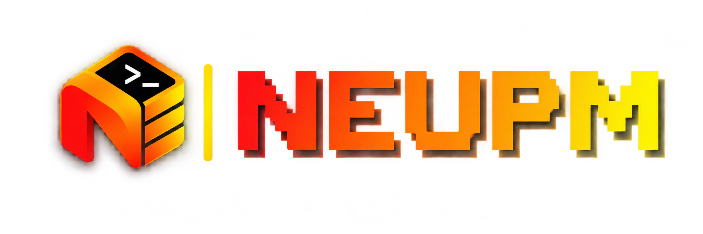
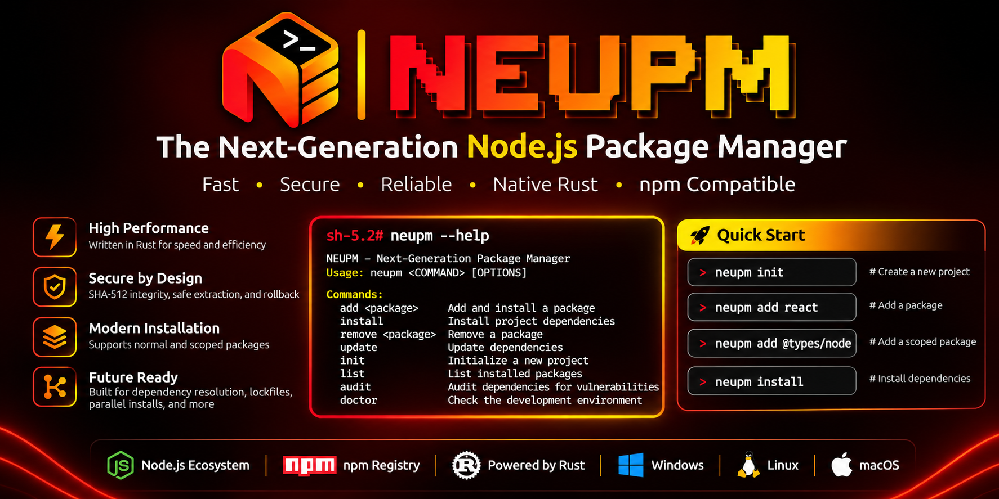

<div align="center">
  

  <h3>The Next-Generation Node.js Package Manager</h3>

  <p>A Rust-powered package manager designed for the modern Node.js ecosystem.</p>

  <p><strong>Fast · Secure · Reliable · Native Rust · npm Compatible</strong></p>

  <p>
    
    
    
    
    
  </p>
</div>

---

<div align="center">
  
</div>

---

## Overview

**NEUPM** is a next-generation Node.js package manager being developed in Rust.

Its goal is to provide a reliable, secure, and efficient package management experience for JavaScript and TypeScript projects while maintaining compatibility with the npm registry.

NEUPM is built around a modular architecture, reusable components, secure package installation, and an extensible foundation for future package management technologies.

The project explores how native Rust performance, intelligent dependency management, optimized installation workflows, and modern caching techniques can improve the Node.js development experience.

## Vision

Build a modern package manager that combines:

- Native Rust performance.
- npm registry compatibility.
- Secure package downloading and extraction.
- Reliable package installation.
- Intelligent dependency resolution.
- Efficient package storage and caching.
- Parallel installation capabilities.
- A modular and extensible architecture.

**The long-term vision is to make NEUPM a powerful package management platform for the modern JavaScript ecosystem.**

---

## Key Features

### 1. Native Rust Architecture

NEUPM is written in Rust, providing a foundation for memory safety, efficient resource management, and high-performance systems programming.

### 2. npm Registry Compatibility

NEUPM communicates with the npm registry to retrieve package metadata, version information, distribution URLs, and integrity information.

### 3. Secure Package Installation

The current installation workflow includes:

- Package tarball downloading.
- SHA-512 integrity verification.
- Archive extraction.
- Normal package installation.
- Scoped package installation.
- Package replacement handling.

### 4. Scoped Package Support

NEUPM supports scoped npm package names, including:

```bash
neupm add @types/node
neupm add @types/react
```

Packages are installed using the expected scoped directory structure:

```text
node_modules/
└── @types/
    ├── node/
    └── react/
```

### 5. Modular Architecture

The project is designed around small, reusable Rust modules.

Each major responsibility is separated into dedicated components, including registry communication, archive extraction, package installation, manifest management, dependency resolution, security, and caching.

### 6. Future-Ready Design

NEUPM is being designed to support future capabilities such as:

- Parallel package downloading.
- Intelligent dependency resolution.
- Content-addressable package storage.
- Advanced caching.
- Dependency graph optimization.
- AI-assisted package management.
- Advanced package security analysis.

These capabilities are part of the development roadmap and are not all implemented yet.

---

## Quick Start

### Prerequisites

- Rust toolchain.
- Cargo.
- Git.
- Windows 11, Linux, or macOS development environment.

### Clone the Repository

```bash
git clone https://github.com/YOUR_USERNAME/neupm.git
cd neupm
```

Replace `YOUR_USERNAME` with your GitHub username.

### Build from Source

```bash
cargo build --release
```

The release executable is generated at:

**Windows**

```text
target/release/neupm.exe
```

**Linux / macOS**

```text
target/release/neupm
```

### Verify the Installation

```bash
neupm --version
neupm --help
```

If you have not added the executable to your system PATH, run it using its full path.

---

## CLI Commands

NEUPM provides a command-line interface designed around a simple package management workflow.

| Command | Description |
|---|---|
| `neupm --help` | Display available commands |
| `neupm --version` | Display the installed version |
| `neupm init` | Initialize a new project |
| `neupm add <package>` | Add and install a package |
| `neupm install` | Install project dependencies |
| `neupm remove <package>` | Remove a package |
| `neupm update` | Update dependencies |
| `neupm list` | List installed packages |
| `neupm audit` | Audit project dependencies |
| `neupm doctor` | Check the development environment |

Command availability and implementation status may vary during development.

### Command Examples

Initialize a project:

```bash
neupm init
```

Install React:

```bash
neupm add react
```

Install Node.js TypeScript definitions:

```bash
neupm add @types/node
```

Install React TypeScript definitions:

```bash
neupm add @types/react
```

Install project dependencies:

```bash
neupm install
```

Display installed packages:

```bash
neupm list
```

Display available commands:

```bash
neupm --help
```

---

## How NEUPM Works

The current package installation workflow follows these steps:

```text
                 NEUPM CLI
                     |
                     v
            Package Specification
                     |
                     v
               npm Registry
                     |
                     v
             Package Metadata
                     |
                     v
              Tarball Download
                     |
                     v
            SHA-512 Verification
                     |
                     v
              Archive Inspection
                     |
                     v
               Safe Extraction
                     |
                     v
             Package Installation
                     |
                     v
              package.json Update
```

The architecture is being expanded to include dependency graph resolution, lockfile generation, package caching, and reproducible installations.

---

## Technology Stack

| Technology | Purpose |
|---|---|
| Rust | Core package manager implementation |
| Cargo | Build system and dependency management |
| Tokio | Asynchronous runtime |
| Clap | Command-line argument parsing |
| Reqwest | HTTP communication |
| Serde JSON | JSON processing |
| SHA-2 | Package integrity verification |
| Base64 | Integrity encoding and decoding |
| flate2 | Gzip decompression |
| tar | Archive processing |
| tempfile | Temporary installation directories |

---

## Project Architecture

NEUPM follows a modular architecture intended to keep components small, reusable, testable, and independently maintainable.

```text
neupm/
│
├── Cargo.toml
├── Cargo.lock
├── README.md
│
├── assets/
│   ├── logo.png
│   └── banner.png
│
├── src/
│   ├── main.rs
│   ├── lib.rs
│   ├── app.rs
│   │
│   ├── cli/
│   │   ├── mod.rs
│   │   ├── arguments.rs
│   │   ├── commands.rs
│   │   ├── output.rs
│   │   └── progress.rs
│   │
│   ├── commands/
│   │   ├── add/
│   │   ├── install/
│   │   ├── remove/
│   │   ├── update/
│   │   ├── init/
│   │   ├── list/
│   │   ├── doctor/
│   │   └── audit/
│   │
│   ├── core/
│   ├── registry/
│   ├── resolver/
│   ├── installer/
│   ├── archive/
│   ├── manifest/
│   ├── lockfile/
│   ├── store/
│   ├── cache/
│   ├── security/
│   ├── network/
│   ├── config/
│   ├── diagnostics/
│   ├── telemetry/
│   ├── utils/
│   │
│   └── future/
│       ├── ai/
│       ├── parallel/
│       ├── intelligent_cache/
│       ├── distributed/
│       ├── optimization/
│       ├── security/
│       └── experimental/
│
├── tests/
│   ├── cli/
│   ├── registry/
│   ├── resolver/
│   ├── installer/
│   ├── archive/
│   ├── manifest/
│   ├── lockfile/
│   ├── security/
│   └── fixtures/
│
├── benches/
├── examples/
├── docs/
└── scripts/
```

*This tree represents the intended architecture. Some directories and modules are planned and may not yet exist in the repository.*

### Core Modules

| Module | Responsibility |
|---|---|
| `cli/` | CLI arguments, commands, and terminal output |
| `commands/` | Individual package manager commands |
| `core/` | Shared package types and application logic |
| `registry/` | npm registry communication and metadata |
| `resolver/` | Dependency and version resolution |
| `installer/` | Package installation and replacement |
| `archive/` | Archive inspection and extraction |
| `manifest/` | package.json parsing and updates |
| `lockfile/` | Dependency lockfile management |
| `store/` | Package storage |
| `cache/` | Metadata and package caching |
| `security/` | Integrity checks and package security |
| `network/` | HTTP communication and network policies |
| `config/` | Application configuration |
| `diagnostics/` | Environment checks and diagnostics |
| `telemetry/` | Logging, tracing, and metrics |
| `utils/` | Reusable utilities |

---

## Futuristic Implementation

NEUPM includes a dedicated `future/` architecture for researching and developing next-generation package management capabilities.

The goal is to keep experimental technologies separate from the stable installation engine.

### AI-Powered Package Management

Planned capabilities:

- AI package assistant.
- Dependency recommendations.
- Installation error explanations.
- Dependency upgrade suggestions.

### Parallel Execution Engine

Planned capabilities:

- Parallel package downloads.
- Concurrent dependency resolution.
- Intelligent task scheduling.
- Optimized worker pools.

### Intelligent Caching

Planned capabilities:

- Predictive package caching.
- Adaptive cache policies.
- Cache reuse.
- Reduced redundant downloads.

### Distributed Package Infrastructure

Planned capabilities:

- Remote package storage.
- Shared package caches.
- Distributed synchronization.

### Installation Optimization

Planned capabilities:

- Dependency graph optimization.
- Memory optimization.
- I/O optimization.
- Improved installation planning.

### Advanced Security

Planned capabilities:

- Package behavior analysis.
- Risk scoring.
- Anomaly detection.
- Advanced dependency auditing.

**All futuristic capabilities are experimental or planned until their implementations and tests are available.**

---

## Development Roadmap

NEUPM is under active development.

| Phase | Feature | Status |
|---|---|---|
| 01 | Rust CLI foundation | In progress |
| 02 | npm registry integration | Implemented |
| 03 | Package downloading | Implemented |
| 04 | SHA-512 integrity verification | Implemented |
| 05 | Normal package installation | Implemented |
| 06 | Scoped package installation | Implemented |
| 07 | Modular architecture | In progress |
| 08 | Dependency resolution | Planned |
| 09 | Semantic version resolution | Planned |
| 10 | Lockfile support | Planned |
| 11 | Recursive dependency installation | Planned |
| 12 | Package store and caching | Planned |
| 13 | Parallel installation engine | Planned |
| 14 | Advanced security and auditing | Planned |
| 15 | AI-assisted package management | Future |
| 16 | Distributed package infrastructure | Future |

The roadmap reflects development intentions and may change as the project evolves.

---

## Performance Philosophy

NEUPM is built in Rust with performance as an architectural priority.

The project focuses on:

- Efficient network operations.
- Reduced unnecessary downloads.
- Reusable package storage.
- Optimized dependency resolution.
- Parallel execution where safe.
- Efficient filesystem operations.
- Controlled memory usage.

Performance comparisons with npm, pnpm, or Yarn should be based on reproducible benchmarks rather than assumptions.

---

## Security Philosophy

Package security is a fundamental part of NEUPM's design.

The current implementation includes SHA-512 verification of downloaded package tarballs.

Future security work includes:

- Strong archive path validation.
- Safe package replacement.
- Transaction rollback.
- Dependency vulnerability analysis.
- Package risk assessment.
- Controlled lifecycle script execution.

Users should continue to review package sources and dependencies before installing third-party software.

---

## Contributing

Contributions, suggestions, bug reports, and discussions are welcome.

Before submitting a contribution:

1. Check existing issues.
2. Follow the modular architecture.
3. Keep functions focused and reusable.
4. Add tests for new functionality.
5. Run formatting and compilation checks.
6. Document significant architectural changes.

### Development Commands

Format the code:

```bash
cargo fmt
```

Check compilation:

```bash
cargo check
```

Run tests:

```bash
cargo test
```

Build an optimized release:

```bash
cargo build --release
```

---

## Project Status

**NEUPM is an early-stage, actively developed package manager.**

The current implementation establishes the foundation for npm registry integration, package downloading, integrity verification, archive extraction, and package installation.

Features such as complete recursive dependency resolution, lockfiles, advanced caching, and full npm compatibility remain under development.

The project is not yet recommended as a drop-in replacement for npm or pnpm in production environments.

---

## License

See the [LICENSE](LICENSE) file for licensing information.

---

<div align="center">
  

  <h3>Building the Future of Node.js Package Management.</h3>

  <p>Native Rust. Modular Architecture. Next-Generation Package Management.</p>

  <p><code>neupm add react</code></p>

  <p>Made with Rust for the Node.js ecosystem.</p>
</div>